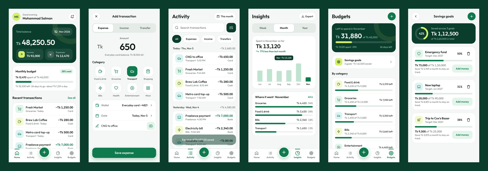

# fintracker

An expense manager for Android and iOS, built with Expo (React Native), TypeScript and Reanimated. Light theme, Outfit type, green palette, amounts in Bangladeshi Taka (`Tk 1,50,000`).



A screen recording of the main flow is in [`docs/demo.mp4`](docs/demo.mp4).

## Run it

```bash
cd fintracker
npm install
npx expo start
```

- **Phone:** install the Expo Go app, then scan the QR code from the terminal.
- **Browser:** press `w` in the terminal, or run `npx expo start --web`.
- **Store builds:** `npx eas-cli@latest build --platform android` (or `ios`). This needs an Expo account.

Checks: `npx tsc --noEmit`, `npx expo lint`, `npx expo-doctor`.

## What's in it

All 19 screens from the design canvas:

| Area | Screens |
|---|---|
| Welcome & access | Animated splash · 3-step onboarding · Sign up · Log in (fingerprint too) · Verify code & reset password · Quick setup |
| Daily tracking | Home · Add/edit transaction (expense, income, transfer) · Activity · Transaction details · Filters |
| Planning | Budgets · Create/edit budget · Savings goals |
| Insights & alerts | Insights (week/month/year trends, category split) · Notifications |
| Account | Wallets · Categories · Profile & settings |

Everything works end to end:
- Adding a transaction updates balances, budgets, Insights and Activity.
- Deleting from a swipe or from the detail screen offers Undo.
- Receipts are real photos from the library.
- Export shares a CSV on a phone and downloads one in the browser.
- Data is saved on the device.

### Motion and interaction

- **Navigation:** native slide transitions between screens, and slide-up modals for Add and Budget.
- **Tab bar:** a sliding indicator, icons that bounce when selected, and a centre add button that springs when pressed.
- **Buttons and cards:** shrink slightly when pressed, with haptics on iOS and Android.
- **Bottom sheets:** spring up, dim the background and can be dragged down to close. Used for filters, wallet, date and category pickers, split, and goals.
- **Numbers and progress:** balances count up, progress bars and rings fill in, and chart bars spring to new values when the period changes.
- **Onboarding:** illustrations move at a different speed from the page (parallax) and the page dots stretch as you swipe.
- **Lists:** items stagger in, reflow smoothly when filtered, and can be swiped to delete or dismiss.
- **Forms:** fields highlight on focus, shake on errors and show the error in place. The code boxes pop as you type and the password meter fills.
- **Reduced motion:** if the phone is set to reduce motion, the system setting is respected.

### Accessibility

- Every control has a role and a label.
- Toggles report their state to screen readers.
- Tap targets are at least 44pt.
- Text contrast is at least 4.5:1.
- Budget warnings use an icon and text, not colour alone.

## Project layout

```
src/
  app/           Screens (Expo Router file-based routes)
    (auth)/      welcome, sign-up, log-in, verify, setup
    (tabs)/      home, activity, insights, budgets
    add.tsx, budget-edit.tsx, transaction/[id].tsx, goals, notifications, wallets, categories, profile
  components/    UI kit: buttons, fields, sheets, segmented control, switches, progress, tab bar, toasts
  store/         Zustand store saved to the device with AsyncStorage
  lib/           Money/date formatting, finance calculations, CSV export, haptics, animation hooks
  data/          Types and the sample data set
  theme/         Colours, type scale, springs
```

## Before shipping

- **Accounts are local to the device.** There is no server yet. Sign up, log in, the email code and password reset all run on the device, and any 6-digit code is accepted. Connect these to your auth provider (for example, Supabase or Firebase) before release.
- **Currency is fixed to BDT.** Setup and Settings show it but don't let you change it.
- **Sample data:** new accounts can start with a realistic sample month (a switch in Setup). Settings can load or clear it.
